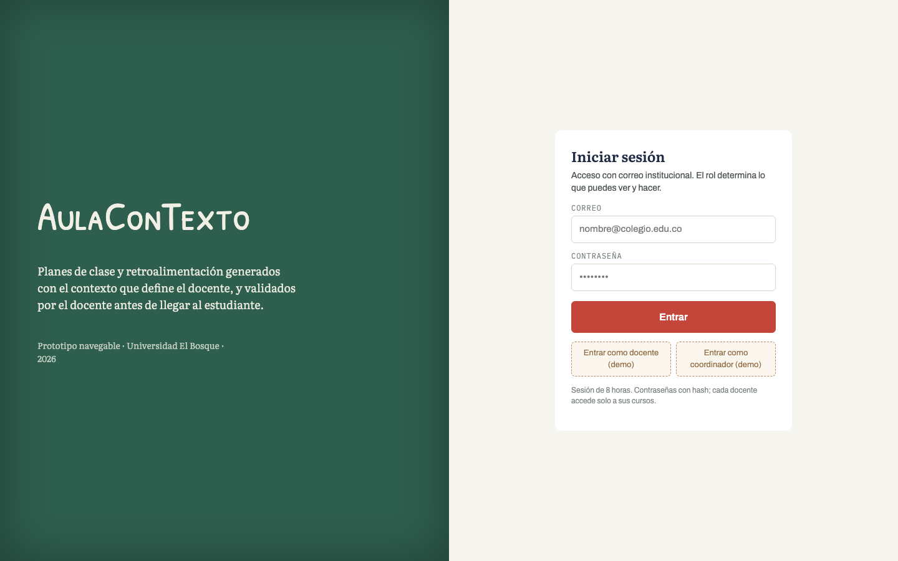
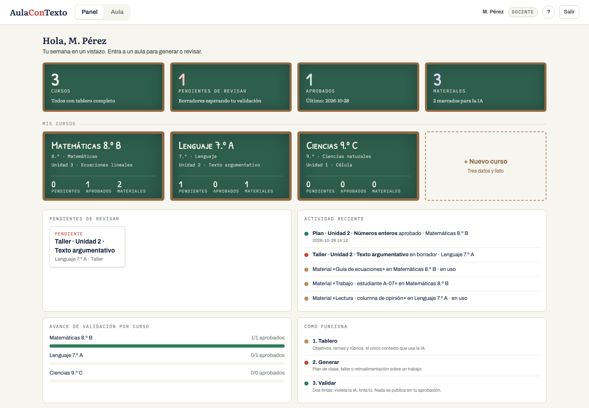
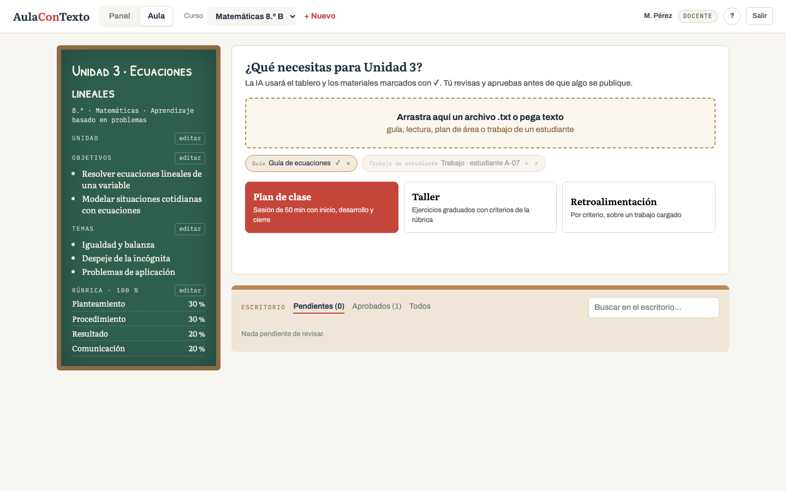
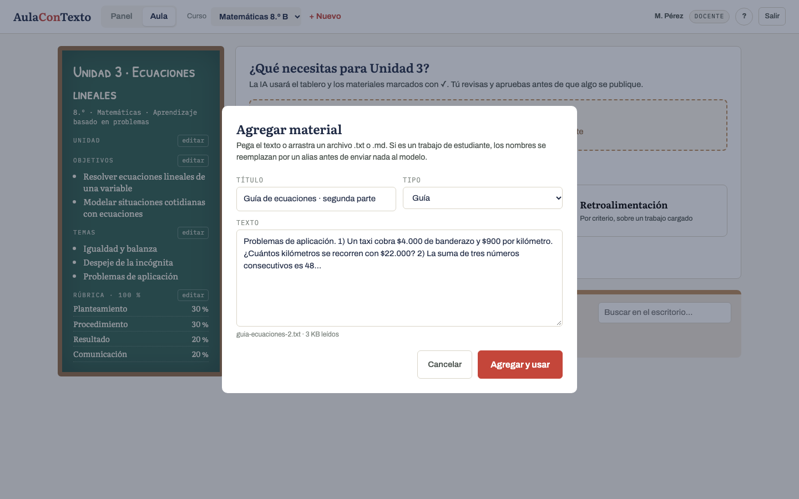
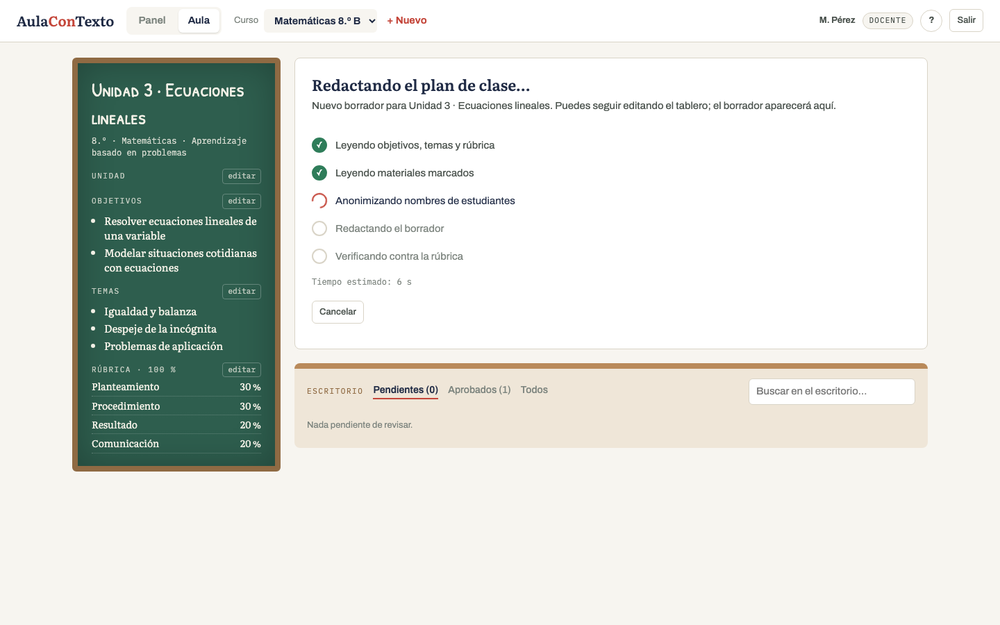
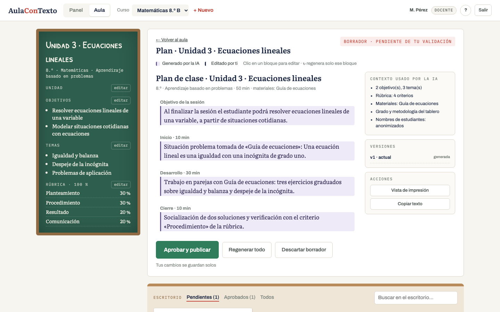
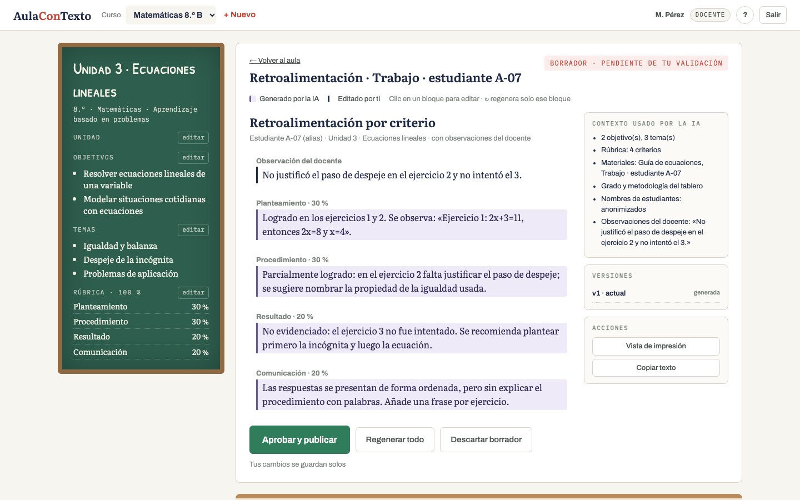
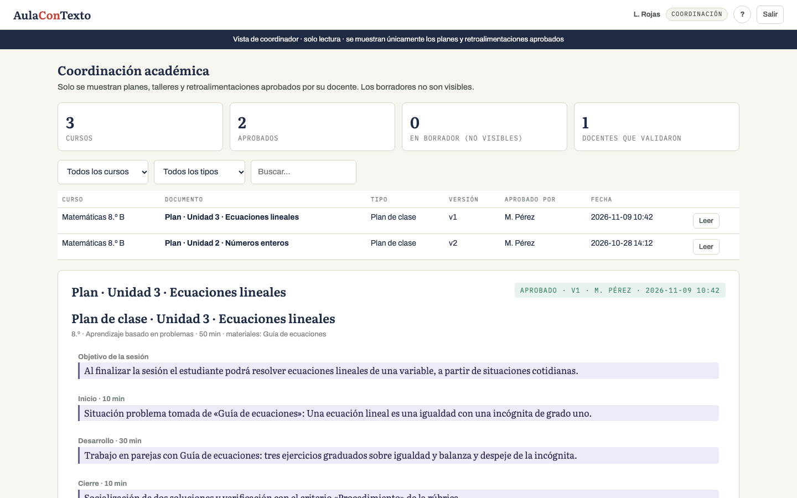

# AulaConTexto · Informe de diseño del prototipo navegable

Equipo: Buitrago Karen · Cañón Andrés · Mora Nicolás · Seminario de Investigación · noviembre de 2026

Entregables: (1) cuatro conceptos visuales, (2) prototipo v1, (3) revisión UX, (4) entrevistas de usabilidad con tres agentes de IA que encarnan perfiles de usuario, (5) rediseño del flujo en tres versiones, (6) prototipo v2 con la versión elegida, (7) ampliación de la v2 con los hallazgos de las entrevistas y un panel de inicio tipo dashboard.

Prototipos: v1 `prototipo-v1.html` · v2 `prototipo-v2.html` (ambos navegables, sin backend; la generación está simulada).

---

## 1. Conceptos visuales evaluados

| | Concepto | Metáfora | Qué resuelve mejor | Por qué no se eligió |
|---|---|---|---|---|
| 1 | Mesa de trabajo | Fichas y materiales sobre una mesa | Convierte el contexto en gestos | Arrastrar fichas es costoso en pantallas pequeñas y para baja afinidad digital |
| 2 | Libreta inteligente | Cuaderno por curso, página docente / página IA | Autoría clara línea a línea | Débil para el rol de coordinador; la generación queda escondida en el margen |
| 3 | **Aula digital** | Tablero (contexto), estantes (materiales), escritorio (validación) | Refleja la arquitectura real y da lugar al coordinador | — elegido — |
| 4 | Taller de diseño | Lienzo con variaciones de IA | Explota la generación sin chat | Riesgo de parecer Canva; favorece al usuario experto |

Se eligió **Aula digital** y se tomó de Libreta inteligente la regla de **dos tintas**: lo generado y lo editado por el docente se distinguen siempre por color y borde.

---

## 2. Revisión UX del prototipo v1

Rol asumido: diseñador senior con referentes de Duolingo (claridad de una acción por pantalla), Canva (edición directa sobre el resultado) y Notion (jerarquía tipográfica). Revisión heurística sobre las cinco pantallas de v1.

### 2.1 Problemas visuales
1. La rúbrica, como afiche flotante, **tapa el título del tablero** y se corta en pantallas de 1360 px.
2. Los objetivos y temas en tipografía de tiza (Patrick Hand SC) son legibles como título pero **no como texto de lectura**: en objetivos de dos líneas la legibilidad cae.
3. La leyenda de dos tintas es de 12 px y gris: el mecanismo central del producto es casi invisible.
4. El spinner de "Procesando…" no informa nada: ni etapas, ni tiempo, ni opción de cancelar.
5. El escritorio vacío muestra un texto gris que compite con el tablero; el ojo no sabe dónde empezar.

### 2.2 Elementos genéricos
6. Barra superior con "Mis cursos · Vista coordinador · Ayuda · usuario" y una cuadrícula de tarjetas: es la primera pantalla de cualquier SaaS. El aula solo existe en la segunda pantalla.
7. Asistente de creación de curso en 4 pasos con barra de progreso: patrón de formulario administrativo.
8. Toasts como único sistema de retroalimentación.

### 2.3 Componentes débiles
9. El botón "Generar…" abre un modal que vuelve a pedir tipo, unidad y materiales, **información que ya está en el tablero**. Es un paso redundante.
10. Marcar un material "en uso" se hace con clic sobre el libro, sin pista visual previa: nadie lo descubre.
11. "Aprobar" y "Regenerar" tienen casi el mismo peso visual; "Exportar PDF" aparece deshabilitado sin explicar por qué.
12. "Editar contexto" existe pero no hace nada.
13. La rúbrica debe sumar 100 % antes de poder crear el curso: bloqueo innecesario en el primer contacto.

### 2.4 Oportunidades de diferenciación
- La **validación docente como acto visible**: hoy es un botón verde más; debería ser el momento más claro de la pantalla.
- **Regenerar por bloque**, no todo el documento: ningún asistente genérico lo hace bien y es coherente con la tesis de que el docente conserva el control.
- **Mostrar qué contexto usó la IA** antes y después de generar: trazabilidad como argumento de confianza.
- La **vista del coordinador** como el mismo aula en solo lectura, no como otra pantalla.

---

## 3. Evaluación de usabilidad con agentes de IA (v1)

Método: tres agentes de IA (modelo Claude), cada uno instruido para encarnar un perfil de usuario, recorrieron el código fuente del prototipo v1 con un protocolo de sesión moderada y pensamiento en voz alta, y produjeron transcripción por tarea, cuestionario SUS y preguntas abiertas. Las transcripciones completas están en `evidencia/`. Lo que sigue es un resumen anticipado elaborado durante el diseño; los resultados consolidados y verificados están en el Informe de uso de IA y evaluación (sección 3). No son datos de docentes reales; se tratan como hipótesis de diseño que se validarán en Proyecto de Grado I.

**Tareas.** T1 crear un curso · T2 subir un material y usarlo · T3 generar un plan de clase · T4 revisar, editar y aprobar · T5 (coordinador) encontrar los planes aprobados.

### Usuario 1 · Docente de primaria, baja afinidad tecnológica

| Tarea | Resultado | Observación |
|---|---|---|
| T1 | Completada con ayuda · 6 min | Se detuvo en "Metodología": «¿qué pongo aquí?». En la rúbrica no sumó 100 y el sistema la bloqueó dos veces. |
| T2 | Fallida | Subió el material pero no entendió que había que hacer clic en el libro para "usarlo". Generó el plan sin material. |
| T3 | Completada · 2 min | El modal "Generar" la confundió: «¿otra vez la unidad? ya la escribí». |
| T4 | Parcial | Editó una frase pero no notó el cambio de color. Preguntó «¿esto ya se lo mando a los niños?» antes de aprobar. |

Comentarios: «El tablero verde me gusta, se siente como mi salón.» · «Me da miedo dañar algo.» · «¿Dónde quedó lo que subí?»
Puntos de confusión: estado "en uso" de materiales; diferencia entre borrador y aprobado; el spinner («¿se quedó pegado?»).
Sugerencias: un solo botón grande para empezar; que el sistema diga qué está haciendo.

### Usuario 2 · Docente universitario, alta experiencia digital

| Tarea | Resultado | Observación |
|---|---|---|
| T1 | Completada · 2 min | Criticó el asistente de 4 pasos: «esto cabe en una pantalla». |
| T2 | Completada · 1 min | Descubrió el clic en el libro por ensayo; pidió arrastrar y soltar y carga múltiple. |
| T3 | Completada | Quiso elegir qué secciones regenerar; regeneró todo y perdió la edición anterior. |
| T4 | Completada con fricción | Pidió historial de versiones y comparación. Notó la leyenda de tintas pero la consideró «muy escondida». |

Comentarios: «El modal de generar es redundante.» · «Quiero regenerar solo el cierre, no todo.» · «¿Qué contexto exactamente le mandaste al modelo?»
Puntos de confusión: pérdida de ediciones al regenerar; ausencia de atajos.
Sugerencias: regeneración por bloque; mostrar el contexto usado; edición en línea sin modal.

### Usuario 3 · Coordinador académico

| Tarea | Resultado | Observación |
|---|---|---|
| T5 | Completada · 1 min | Encontró la vista, pero solo lista títulos: «necesito leer el plan, no el nombre». |
| Extra | — | Preguntó quién aprobó y cuándo; la información existe en el modelo de datos pero no se muestra. |
| Extra | — | Quiso filtrar por curso y por periodo. |

Comentarios: «Para mí el valor es ver que el profesor lo revisó.» · «Si no veo el contenido, esta pantalla no me sirve.»
Sugerencias: vista de solo lectura del aula completa, con autor de la aprobación y fecha; filtros por curso.

### Hallazgos consolidados (priorizados)

| # | Hallazgo | Usuarios | Severidad |
|---|---|---|---|
| H1 | Materiales "en uso" no se descubren | U1, U2 | Alta |
| H2 | Modal "Generar" repite el contexto del tablero | U1, U2 | Alta |
| H3 | Procesamiento sin información ni cancelación | U1 | Alta |
| H4 | Regenerar borra las ediciones del docente | U2 | Alta |
| H5 | Distinción borrador/aprobado y dos tintas poco visibles | U1, U2 | Media |
| H6 | Asistente de 4 pasos con rúbrica bloqueante | U1, U2 | Media |
| H7 | Vista del coordinador sin contenido ni trazabilidad | U3 | Media |
| H8 | Tipografía de tiza en texto de lectura | U1 | Baja |

---

## 4. Rediseño del flujo principal

Tarea objetivo: **subir contenido de una clase → generar material con IA → revisar resultado**.

Análisis previo:
- **UX.** El flujo v1 tiene 7 pasos con 3 modales. La decisión "qué generar" se pide dos veces.
- **Arquitectura de información.** Tres niveles (cursos → aula → resultado) para una tarea que el docente repite cada semana. El curso debe ser contexto persistente, no pantalla.
- **Jerarquía visual.** El tablero domina pero no es accionable; la acción principal es un botón pequeño debajo.
- **Microinteracciones.** No hay retroalimentación durante la espera ni al editar; la única señal es un toast.
- **Llamadas a la acción.** "Generar…" con puntos suspensivos anuncia más formularios; "Aprobar" compite con "Regenerar".

### <<VERSION A>> · Un solo tablero
**Mejoras.** Se elimina el modal "Generar": un botón primario "Generar plan de esta unidad" usa directamente el tablero y los materiales marcados. Los materiales pasan de libros a chips con interruptor visible. El progreso se muestra en el escritorio. Asistente de curso reducido a 2 pasos; la rúbrica se ajusta proporcionalmente en lugar de bloquear.
**Justificación.** Ataca H1, H2 y H6 sin cambiar la arquitectura de pantallas; conserva todo lo que funcionó del concepto.
**Ventajas.** Bajo costo de cambio; mantiene el modelo mental ya validado (tablero, estantes, escritorio).
**Riesgos.** Siguen existiendo tres pantallas; el docente de baja afinidad aún debe entender "curso → aula" antes de generar.

### <<VERSION B>> · Empieza por el material, todo en el aula
**Mejoras.** Una sola pantalla por curso. A la izquierda el tablero (contexto, editable en el sitio, tipografía legible). Al centro una zona de trabajo cuyo primer elemento es "Suelta aquí un material o pega texto"; debajo, un único botón primario "Generar plan de clase" y uno secundario "Retroalimentar un trabajo", habilitado solo cuando existe un trabajo cargado. El procesamiento se muestra en la misma zona con cinco etapas con nombre, tiempo estimado y cancelar. El resultado reemplaza la zona de trabajo: dos tintas con leyenda visible, edición en línea con guardado automático, **regenerar por bloque** al pasar el mouse, y un único botón verde "Aprobar y publicar". El escritorio queda como franja inferior con pestañas Pendientes / Aprobados. Crear curso pide tres datos y usa una rúbrica base. El coordinador ve la misma pantalla en solo lectura con quién aprobó.
**Justificación.** Resuelve H1–H7 en conjunto. Reduce de 7 pasos a 3 (soltar material → generar → aprobar) y de 3 modales a 0 en el flujo principal. La IA deja de ser un formulario y pasa a ser una consecuencia del contexto que el docente ya ve.
**Ventajas.** Menor carga cognitiva para U1; control fino para U2; trazabilidad para U3. Mantiene la metáfora del aula.
**Riesgos.** Pantalla densa en portátiles pequeños; el tablero editable en el sitio puede inducir a "arreglar el contexto" en lugar de generar; la regeneración por bloque exige al backend prompts parciales (viable con la arquitectura actual).

### <<VERSION C>> · Asistente guiado de tres preguntas
**Mejoras.** El flujo se convierte en tres preguntas secuenciales en pantalla completa: «¿Para qué unidad?» → «¿Con qué material?» → «¿Plan o retroalimentación?», con el borrador apareciendo progresivamente mientras se redacta. El contexto del curso se infiere y se muestra como resumen al final.
**Justificación.** Máxima reducción de carga para docentes de baja afinidad; una decisión por pantalla.
**Ventajas.** Casi imposible perderse; buen onboarding.
**Riesgos.** Se acerca a la experiencia de chat que el proyecto quiere evitar; esconde el tablero y la rúbrica, que son el argumento diferenciador; frustra al usuario experto con pasos obligatorios; el coordinador no tiene lugar.

### Decisión
Se implementa **Versión B** en el prototipo v2, incorporando de A la simplificación del alta de curso y de C la pista inicial de tres líneas que se puede descartar.

---

## 5. Prototipo v2 · qué cambió respecto a v1

| Hallazgo | Cambio en v2 |
|---|---|
| H1 | Materiales como chips con ✓/+; al agregar uno queda marcado para usarse. |
| H2 | Sin modal: "Generar plan de clase" usa el tablero tal como está. |
| H3 | Progreso con cinco etapas nombradas (incluida la anonimización), tiempo estimado y cancelar. |
| H4 | Regenerar por bloque; las ediciones se guardan solas; "Regenerar todo" pasa a secundario. |
| H5 | Leyenda de dos tintas en la cabecera del resultado; bloques generados con fondo violeta y borde; estado como etiqueta coloreada. |
| H6 | Nuevo curso en un paso con tres datos; rúbrica base; edición del tablero en el sitio. |
| H7 | Coordinador: misma aula, solo lectura, contenido completo y quién aprobó. |
| H8 | Tiza solo en el título de la unidad; objetivos, temas y rúbrica en Literata. |

### 5.1 Ampliación de la v2 tras las entrevistas con agentes

Las tres entrevistas (ver `evidencia/` y el Informe de uso de IA y evaluación, sección 3) señalaron carencias que la versión B no cubría. Se atendieron en la misma v2:

| Hallazgo de las entrevistas | Perfil | Cambio |
|---|---|---|
| Sin autor ni fecha de aprobación | P3 | Cada aprobación registra autor, fecha y hora; se muestra en la etiqueta de estado y en la tabla de coordinación. |
| Coordinación sin lectura ni filtros | P3 | Vista de coordinación con fichas de resumen, tarjetas por curso, filtros por curso y tipo, buscador y lectura completa del documento. |
| Regenerar borraba ediciones | P2 | Guardado automático; cada regeneración (por bloque o total) crea una versión consultable desde el panel «Versiones». |
| Grado solo 6.º–11.º; contexto no editable | P1, P2 | Grados 1.º a 11.º; unidad, objetivos, temas y rúbrica editables en el tablero. |
| «Aprobar» publicaba sin aviso | P1, P2, P3 | Confirmación previa que indica quién verá el documento. |
| Retroalimentación con el mismo párrafo por criterio | P3 | Texto distinto por criterio; el docente elige el trabajo y agrega sus observaciones, que se incorporan al borrador y al panel de contexto. |
| Solo texto pegado | P1, P2 | Arrastrar archivos .txt o .md; se lee el contenido y se muestra la vista previa. |
| Sin inicio de sesión ni roles visibles | — | Pantalla de inicio de sesión con rol (docente / coordinación), coherente con la decisión de autenticación de la propuesta. |
| Un solo tipo de generación | P2 | Tres acciones directas: plan de clase, taller y retroalimentación. |

### 5.2 Panel de inicio tipo dashboard

Motivación: tras la ampliación, el docente entraba directo al aula y la primera pantalla era texto y un tablero. Un docente con varios cursos necesita ver de un vistazo qué tiene pendiente antes de elegir un aula. Se agregó un **panel de inicio** y una navegación Panel / Aula en la barra superior.

Decisiones de diseño:
- **Fichas de pizarrón.** Los indicadores (cursos, pendientes de revisar, aprobados, materiales) son pequeños tableros verdes con marco de madera y números en tipografía de tiza, con un subtítulo en serif que explica el número. La metáfora del aula se mantiene en lugar de introducir tarjetas blancas genéricas de panel administrativo.
- **Tarjetas por curso.** Cada curso es un tablero con su unidad, grado y asignatura, tres contadores (pendientes, aprobados, materiales) y una alerta si el tablero de contexto está incompleto. La tarjeta punteada «+ Nuevo curso» abre el alta en un paso.
- **Pendientes como fichas.** Los borradores de todos los cursos aparecen como hojas del escritorio; al pulsar una se abre directamente el resultado en su aula.
- **Actividad reciente y avance.** Lista de aprobaciones, borradores y materiales con un punto de color por tipo, y barras de avance de validación por curso.
- **Color por significado.** Rojo para lo pendiente, verde para lo aprobado, violeta para lo que viene de la IA y madera para los materiales, igual que en el aula.

La vista de coordinación recibió las mismas fichas y un resumen por curso (planes, talleres y retroalimentaciones aprobados, última aprobación); al pulsar una tarjeta se filtra la tabla de documentos.

### 5.3 Capturas del prototipo v2

*Figura 1. Inicio de sesión con accesos de demostración por rol.*

*Figura 2. Panel de inicio: fichas de pizarrón, tarjetas por curso, pendientes, actividad y avance.*

*Figura 3. Aula: tablero de contexto, materiales como chips y tres tipos de generación.*

*Figura 4. Carga de material por archivo o texto pegado.*

*Figura 5. Progreso por etapas con anonimización, tiempo estimado y cancelar.*

*Figura 6. Borrador con dos tintas, contexto usado y versiones.*

*Figura 7. Retroalimentación por criterio con alias del estudiante y observación del docente.*

*Figura 8. Coordinación: fichas, resumen por curso, filtros y tabla con autor y fecha.*

Pendiente para la siguiente iteración: prueba con docentes reales en el sprint 0 de Proyecto de Grado I; revisión por coordinación separada de la aprobación del docente; aviso sobre el destino de los datos al cargar trabajos; fragmentos exactos enviados al modelo.
